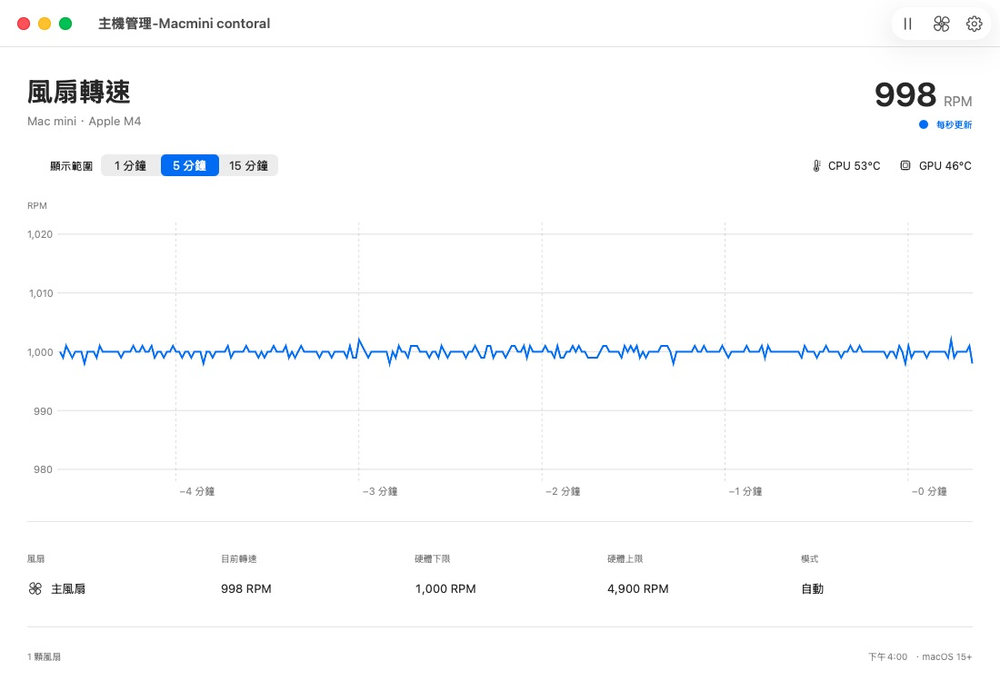
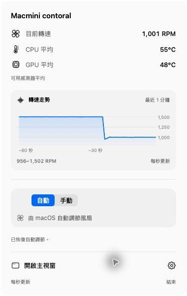

# 風扇管理 Fan Control

Native SwiftUI fan and temperature monitor for macOS 15 or newer. The selected visual reference is `docs/selected-design.png`.

原生 macOS 選單列風扇與溫度監測工具。可即時查看風扇轉速、CPU／GPU 感測器平均溫度及最近 15 分鐘趨勢，並在管理員授權後使用快速調速控制。支援 macOS 15 以上，macOS 26 以上適量採用 Liquid Glass。

已發布 **v1.0.3（build 5）**：加入感測器失效保護、控制服務連線與版本確認、選單列 RPM／CPU／GPU 個別顯示開關、常用轉速快捷鍵與整數轉速輸入。已安裝至本機，完成 M4 Mac mini 上的展開面板、快捷調速、數字輸入與恢復自動驗證。驗證範圍見 [安裝實測紀錄](docs/v1.0.3-install-validation-2026-10-26.md) 與 [本地改善紀錄](docs/v1.0.3-local-improvements.md)。

目前本地開發版為 **v1.0.4（build 6）**：主畫面直接並排顯示所有實際偵測到的風扇，每顆都有獨立 RPM、圖表、目標輸入與快捷調速；多顆時依視窗寬度換行，不需切換風扇。已完成 Universal 建置與模擬版面驗證，尚未安裝或發布；詳見 [多風扇主畫面](docs/multi-fan-dashboard.md)。

[繁體中文使用說明](docs/使用說明.md) · [實機驗證紀錄](docs/validation.md)



v1.0.1 包含風扇控制服務啟動及韌體回讀延遲修正，已於 2026-10-24 在 M4 Mac mini 驗證即時監測、1,500／2,000 RPM 手動調速、降速及恢復自動，見 [手動控制實機測試](docs/manual-control-validation-2026-10-24.md)。macOS 15、Intel 與其他機型尚未完成實機測試。

從 [v1.0.3 Release](https://github.com/eqwgeryfgbdf/Fan-Control/releases/tag/v1.0.3) 下載 Universal DMG；私有倉庫需要登入具有存取權的 GitHub 帳號。

v1.0.2（build 4）正式更名為「風扇管理 Fan Control」，新增選單列迷你轉速走勢，以及展開面板內最近一分鐘的圖表。已完成選單列實機調速、降速、恢復自動與圖表更新驗證，詳見 [選單列與圖表驗證紀錄](docs/menu-bar-chart-validation-2026-10-24.md)。



## Features

- A main dashboard with every detected fan displayed in parallel cards: independent actual RPM, 1/5/15-minute history, firmware limits, mode and target controls. Cards wrap with window width; a single fan fills the available width. Restore All Automatic stays in the toolbar.
- A persistent menu bar item with individually configurable RPM, CPU and GPU temperatures, and an optional monochrome one-minute sparkline. The panel includes a one-minute RPM chart, validated integer input, hardware-filtered 1,500/2,000/2,500 RPM quick actions, Apply, and Restore Automatic.
- Menu bar trends keep updating when the main chart is paused. Missing readings remain gaps; the chart shows real samples only, with a minimum 200 RPM vertical span to avoid amplifying minor sensor noise. The mini sparkline can be turned off in Settings.
- Real readings sampled once per second off the main thread. Pausing the chart does not pause sensor readings or control heartbeats. History stays in memory and is not uploaded.
- macOS 26+ uses the native toolbar appearance and one regular Liquid Glass surface for the interactive fan controls. macOS 15 uses standard material. Reduce Transparency uses an opaque control surface. Data and charts never use custom glass.
- Standard system fonts and SF Symbols. Light and dark appearance follow the system.

## Build and launch

Requires Xcode 26 or newer and a valid Apple Development or Developer ID signing identity in Keychain.

```sh
./scripts/build-app.sh
./scripts/package-dmg.sh
open 'dist/風扇管理 Fan Control.app'
```

The script builds arm64 and x86_64, combines both into universal app/helper executables, embeds the launch daemon, and signs the bundle. Override `SIGNING_IDENTITY` to select a different signing certificate. The minimum OS is encoded as 15.0 in both binary architectures and Info.plist.

The default local development build is 1.0.4 (build 6); the published download remains v1.0.3. `APP_VERSION` and `BUILD_NUMBER` can override these defaults. The packaging script reads that bundle version, creates a DMG with an Applications shortcut and installation notes, verifies the image, and writes its SHA-256 file. It refuses to replace an existing DMG. See [v1.0.3 release notes](docs/release-v1.0.3.md) for the packaged build and validation scope.

Install the app in `/Applications` or your `~/Applications` folder before enabling the control service. The local deliverable uses development signing; it is not a notarized public release.

## Fan control authorization

Monitoring needs no administrator permission. Choose **啟用風扇控制** in the menu panel or Settings to register the bundled helper with Apple's `SMAppService`. macOS may request administrator authentication and approval under System Settings → General → Login Items & Extensions. The application does not collect or save an administrator password.

After approval, choose Manual, select a target within the firmware-reported range, and Apply. The target setting and actual fan speed are displayed separately. A successful write is reported only after mode and target readback; physical RPM can take time to settle.

In v1.0.3, authorization alone does not enable writes. The app verifies the running helper's protocol, version and build first. An older helper shows an update prompt and monitoring remains available. Recovery status stays pending until the helper confirms restoration; the UI also displays the hardware's actual mode separately from the target editor.

When upgrading, restore automatic control and quit the old app before replacing it. Version 1.0.2 renames the app bundle to `風扇管理 Fan Control.app`; remove the old `Macmini contoral.app` from Applications before installing the new bundle to avoid duplicate copies. Launch the new copy from Applications and choose **重新啟動控制服務** in Settings to load the updated helper. If macOS requests approval again, complete it in Login Items & Extensions.

The helper accepts only this app's bundle identifier signed by the same Apple signing team. The app also validates the helper's signature. IPC exposes set-target, restore, ping, and heartbeat; it exposes no arbitrary key writes, shell commands, or filesystem paths.

The service records owned fan IDs before changing hardware in `/var/run/local.macmini.contoral.control.json` (root-owned, mode 0600). It restores owned fans on connection loss, expired 12-second heartbeat lease, serious/critical system thermal state, graceful service termination, and recovery after a service restart. The lease clock includes sleep. The app requests automatic mode before sleep and normal quit. Recovery errors retain journal ownership and are retried. A different program's manual session is not silently taken over.

While manually controlling fans, v1.0.3 independently samples them in the helper. Three seconds of continuous invalid fan readings or loss of a previously available CPU/GPU temperature family triggers automatic recovery, even if app heartbeats continue. Recovery revokes the lease before hardware writes and blocks a new session until recovery finishes. Fault-injection tests exercise this policy using simulated hardware; they are not physical failure tests.

## Compatibility and limits

OS compatibility and hardware sensor compatibility are separate. Temperature maps cover M1–M4 and common Intel keys; unknown or unavailable temperatures show `—`. A model's sensor average means the mean of readable, valid mapped sensors, not case temperature or ambient temperature. SMC keys and fan writes are hardware-specific and are not a stable public Apple API.

Only the local M4 machine has been available for physical verification. macOS 15 and Intel runtime testing require additional machines. An Intel build is not an Intel hardware test. Do not describe a new model as validated until live reading and restoration tests pass on it.

## Checks

```sh
swift test
swift run MacminiProbe 5
```

Core tests cover decoding, range/non-finite validation before any hardware write, persistence before mutation, external manual ownership, write failure restoration, recovery journals, absent temperatures, and the heartbeat boundary. `MacminiProbe` performs read-only JSON sampling.

See `docs/validation.md` and `design-qa.md` for the actual verification record. See `THIRD_PARTY_NOTICES.md` for Stats attribution and the MIT license.

## Apple references

- [Materials and Liquid Glass guidance](https://developer.apple.com/design/human-interface-guidelines/materials)
- [Applying Liquid Glass to custom views](https://developer.apple.com/documentation/swiftui/applying-liquid-glass-to-custom-views)
- [MenuBarExtra](https://developer.apple.com/documentation/swiftui/menubarextra)
- [Charts design guidance](https://developer.apple.com/design/human-interface-guidelines/charts)
- [SMAppService](https://developer.apple.com/documentation/servicemanagement/smappservice)
