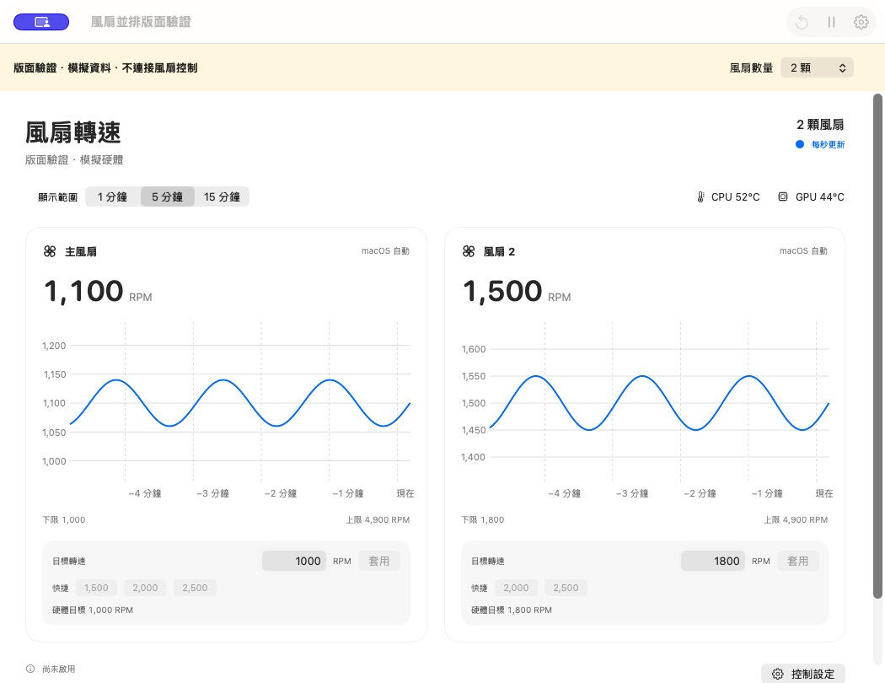

# 所有風扇直接顯示在主畫面

2026-10-26，v1.0.4（build 6）本地開發版。

主畫面改為以硬體 ID 排序的風扇卡片，直接呈現偵測到的全部風扇，不必切換。只有一顆風扇時使用完整寬度；兩顆或更多風扇並排，寬度不足時換行，內容較長時可垂直捲動。不固定假設每台 Mac 都有兩顆風扇。

每張卡片提供即時 RPM、獨立時間曲線、硬體上下限、實際控制模式、目標數字輸入、套用及硬體範圍內的快捷轉速。輸入狀態按卡片分開保存；套用時直接使用該卡片的硬體 ID，重新確認目前讀值及硬體範圍，不依賴選單列所選的風扇。

共同的 1／5／15 分鐘範圍、暫停圖表與 CPU／GPU 溫度保留。主畫面移除原本風扇選擇器及控制彈出視窗；選單列面板仍保留自己的風扇選擇方式，避免選單列過度展開。工具列的「全部恢復自動」會恢復此 App 控制的全部風扇，與既有 helper 的恢復範圍一致，捲動卡片時仍可操作。

## 驗證

- Universal App 與 helper 建置、深度簽章驗證通過，最低 macOS 15；29 項既有測試通過，包含多風扇控制與恢復測試。
- 使用獨立、明確標示模擬資料的預覽程式載入實際 MonitorView，確認 0／1／2／4 顆風扇版面。模擬 ID 使用 0、1、3、5，確認畫面不依賴連續編號。
- 確認每個 ID 的曲線資料各自有 301 筆，將選單列選取 ID 改成 9 仍不影響各卡片的歷史資料。
- 確認雙風扇左右並排；將兩欄分別改成 1600 與 2200，彼此不受影響，捲動四風扇畫面後仍保留。第二顆模擬硬體下限為 1800，其快捷列正確省略 1500。
- 確認單風扇使用整列，無風扇顯示空狀態；1050 與約 824 像素寬度下雙卡片均可讀，四顆的下排可透過捲動查看。
- 本機唯讀確認為一顆風扇、自動模式 0、999–1000 RPM；本輪沒有寫入實機轉速或更新已授權服務。多風扇實體硬體的各卡片調速仍待有對應裝置時驗證。

建置檔：`dist/風扇管理 Fan Control.app`。建置紀錄：`dist/build-v1.0.4.log`；測試紀錄：`dist/tests-v1.0.4.log`；本機版面證據：`dist/dashboard-validation/`。摘要見 [驗證結果](multi-fan-dashboard-validation.json)。

已安裝 App 仍為 v1.0.3。此功能僅保存至本地 Git，未推送 GitHub、未建立 Release 或 DMG。

## v1.0.4 發布更新

本頁上方保留功能完成當時的驗證狀態。2026-10-26 已以英文名稱 Fan Control、build 7 完成打包發布；最新驗證與安裝說明見 [v1.0.4 Release 紀錄](release-v1.0.4.md)。本次發布未取代本機已安裝 App。
